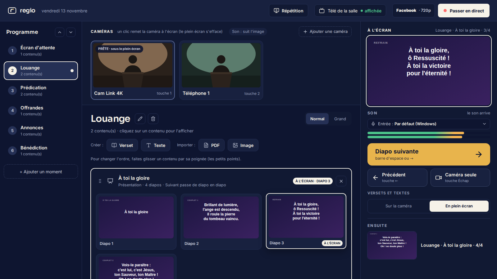
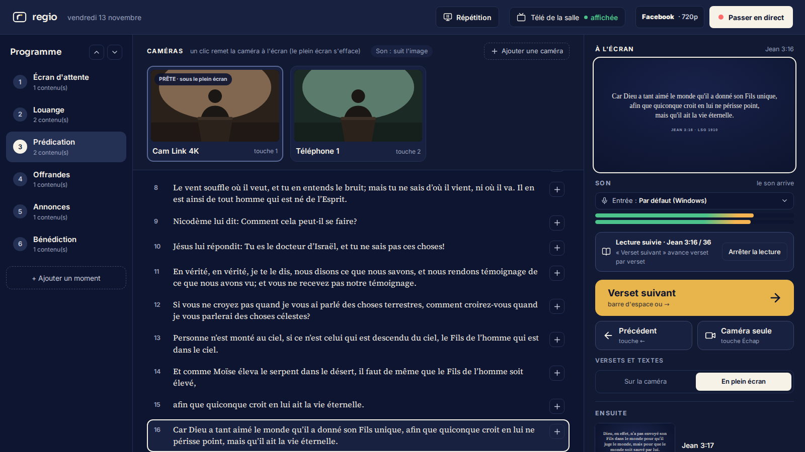
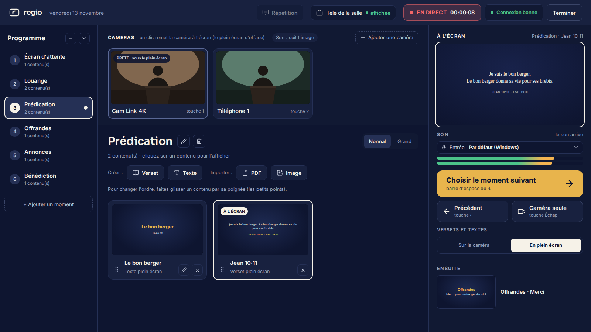
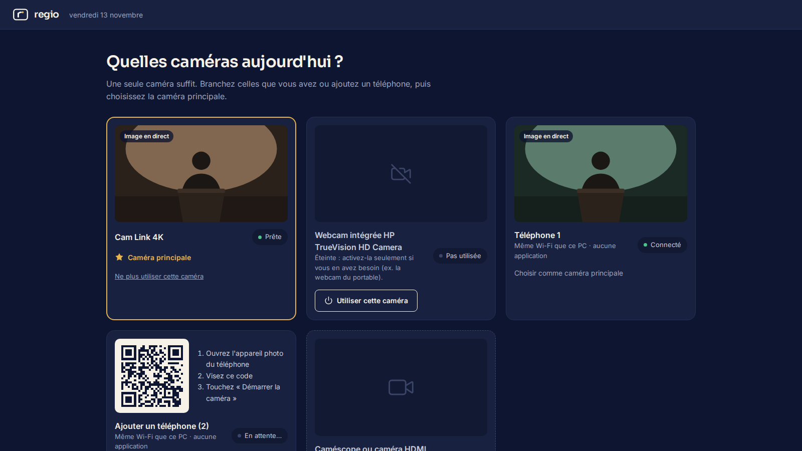

<p align="center">
  
</p>

<p align="center"><b>La régie de vos directs : simple, gratuite, open source.</b><br>
<i>Your live-production desk: simple, free, open source.</i></p>

<p align="center">
  <a href="https://github.com/ngangoula-jaures/Regio/releases/latest"><b>Télécharger pour Windows</b></a> ·
  <a href="#english">English</a> ·
  <a href="CHANGELOG.md">Nouveautés</a>
</p>

<p align="center"></p>

---

## Pour qui ?

**Regio** permet à n'importe qui de **projeter et diffuser en direct** un événement, du début à la fin, sans être technicien :

- **les églises** (c'est pour elles que Regio est né) : projeter les chants, les versets et les annonces dans la salle, et diffuser le culte sur Facebook ;
- **les streamers, créateurs de contenu, associations** : orchestrer un live avec plusieurs caméras, des textes, des images et des présentations.

Regio est pensé pour **peu de matériel** (un téléphone suffit comme caméra), une **connexion Internet faible** et des **PC modestes** (Core i3/i5, 8 Go de mémoire). Tout fonctionne **hors ligne**, sauf la diffusion sur Internet.

## Ce que fait Regio

- **Caméras** : une seule suffit. Un **téléphone devient une caméra en scannant un QR code**, sans application (plusieurs téléphones possibles). Webcam ou boîtier HDMI en option. Un clic, ou les touches 1 à 6, change de caméra.
- **Le son suit l'image** : on entend le micro le plus proche de ce qu'on montre, ou on **garde le son** d'une caméra (montrer l'assemblée en entendant le prédicateur). Entrée son au choix (table de mixage USB, micro).
- **Programme** préparé à l'avance, en moments (« Louange », « Prédication »… ou « Introduction », « Sujet principal »…), puis déroulé avec **Suivant** (barre d'espace).
- **Contenus** : versets, textes et bandeaux, images, **PowerPoint** (rendu fidèle par PowerPoint) et **PDF** : une présentation se déroule diapo par diapo.
- **Bible complète hors ligne** (Louis Segond 1910) : recherche (« jn 3 16 »), livres et chapitres, **lecture suivie** verset par verset.
- **Télé de la salle** (HDMI) : projection automatique, **jamais d'écran noir** (fondus, bascule automatique si une caméra se déconnecte), **mode répétition** pour s'entraîner sans que la salle voie.
- **Direct sur Facebook** : assistant de réglage, test de connexion, qualité adaptée, santé du direct, **enregistrement au choix** sur le PC. YouTube et la diffusion sur plusieurs réseaux arrivent ensuite.

<p align="center">
  
  
</p>

## Installer (Windows 10 et 11)

1. Téléchargez **`Regio_x.y.z_x64-setup.exe`** sur la page des [versions](https://github.com/ngangoula-jaures/Regio/releases/latest).
2. Lancez-le. Tant que l'installeur n'est pas signé, Windows affiche « Windows a protégé votre ordinateur » : cliquez sur **Informations complémentaires**, puis **Exécuter quand même**.
3. Ouvrez **Regio** depuis le menu Démarrer. Le moteur vidéo (OBS Studio, inclus) se met en place tout seul en quelques secondes, **sans Internet**.

L'installation ne demande pas de droits administrateur. Si un composant Windows manque (Visual C++), l'installeur l'ajoute et Windows demande alors l'autorisation.

## Premiers pas

1. **Que préparez-vous ?** Choisissez un programme de départ : culte d'église, live / émission, ou vide.
2. **Caméras du jour** : scannez le QR code avec un téléphone (même Wi-Fi que le PC), ou activez la webcam / le boîtier HDMI.
3. **Télé de la salle** : branchez-la en HDMI, Regio y projette tout seul (Windows : « Étendre » l'affichage).
4. **Dans la régie** : ↑ ↓ choisissent un moment, un clic sur un contenu l'affiche, **espace** passe au suivant, **Échap** revient à la caméra.
5. **Direct** : « Diffuser sur Facebook », collez la clé de stream (une seule fois), puis « Passer en direct ». Écoutez le direct **au casque** : un haut-parleur près des micros crée de l'écho.

<p align="center"></p>

## État du projet

**Version 0.1** : la première version utilisable, testée sur du vrai matériel (webcam, plusieurs téléphones, télé en HDMI, direct Facebook réel avec son). Prochaines étapes : YouTube et diffusion sur plusieurs réseaux en même temps, signature de l'installeur, puis le mode « modifiable » de l'import PowerPoint (sans PowerPoint installé).

Les idées, retours et contributions sont les bienvenus : ouvrez une *issue*.

## Développer

```bash
npm install
npm run dev          # interface dans le navigateur : http://localhost:1420
npm run build        # vérification TypeScript + construction
npm run test:e2e     # tests de bout en bout (serveur de développement lancé)
npx tauri dev        # application de bureau (Windows : Rust + outils C++ requis)
scripts/build-installer.sh   # installeur Windows (OBS et Visual C++ inclus)
```

[Tauri 2](https://tauri.app) (Rust) · React + TypeScript · [OBS Studio](https://obsproject.com) comme moteur vidéo, piloté en coulisses (obs-websocket) · WebRTC pour la caméra du téléphone · [pdf.js](https://mozilla.github.io/pdf.js/).

---

<a id="english"></a>

## English

**Regio** is a free, open-source desktop app (Windows) that lets anyone **project and live-stream** an event from start to finish without being a technician: churches (where Regio started: songs, Bible verses and announcements on the room screen, service streamed to Facebook), and also streamers, creators and associations running a multi-camera live.

- **Cameras**: one is enough. A **phone becomes a camera by scanning a QR code**, no app needed (several phones supported). Webcam or HDMI capture optional.
- **Sound follows the picture**, or **keep the sound** of one camera whatever is shown. Choose the audio input (USB mixing desk, mic).
- **Programme** of moments prepared in advance, then stepped through with **Next** (space bar).
- **Content**: verses, texts and lower thirds, images, **PowerPoint** (faithful rendering through PowerPoint) and **PDF**.
- **Full offline Bible** (Louis Segond 1910, French) with follow-along reading.
- **Room screen** (HDMI): automatic projection, **never a black screen**, **rehearsal mode**.
- **Facebook Live**: setup wizard, connection test, adaptive quality, live health, **optional recording**. YouTube and multi-platform streaming are next.

Built for little equipment, weak internet and modest PCs; works **offline** except for streaming. The interface ships in **French and English**.

**Install**: download `Regio_x.y.z_x64-setup.exe` from [Releases](https://github.com/ngangoula-jaures/Regio/releases/latest). Until the installer is signed, Windows SmartScreen warns: click **More info** › **Run anyway**.

---

## Licence / License

[Apache-2.0](LICENSE). Composants tiers (OBS Studio sous GPL-2.0, polices, Bible, icônes…) : voir [THIRD_PARTY_NOTICES.md](THIRD_PARTY_NOTICES.md) · Third-party components: see [THIRD_PARTY_NOTICES.md](THIRD_PARTY_NOTICES.md).
